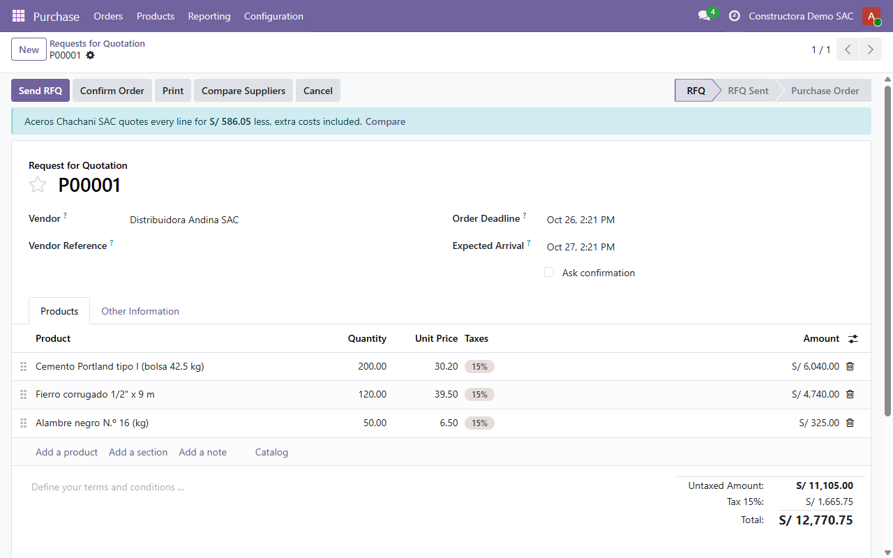
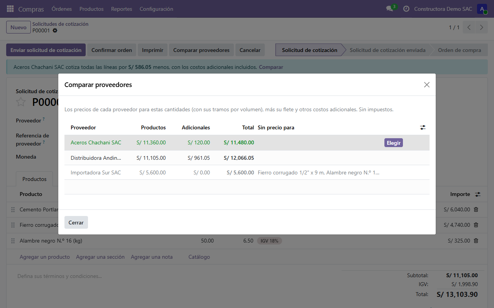
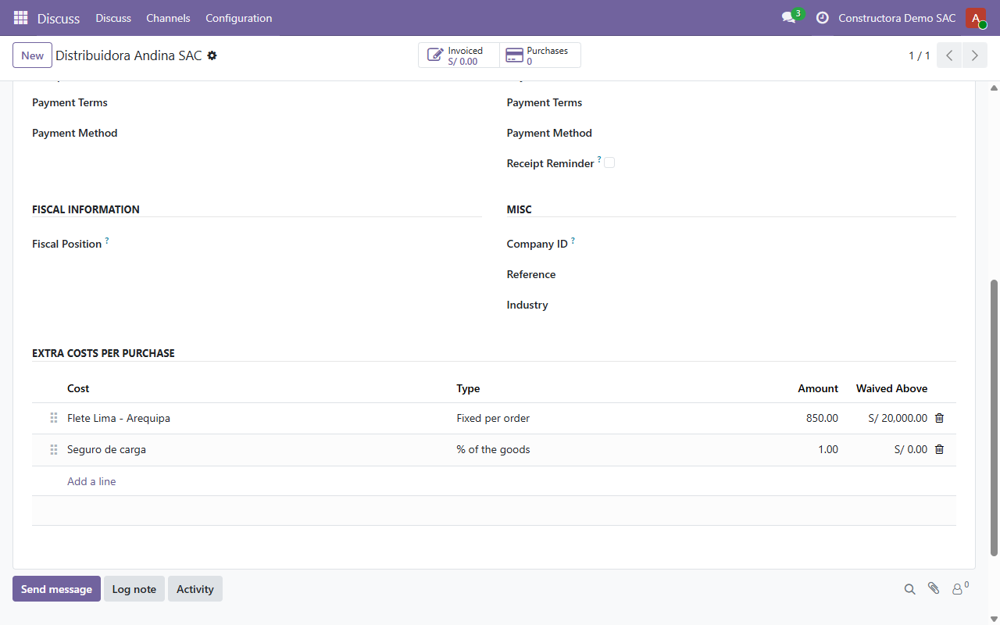

# purchase_supplier_compare

[](https://github.com/sebpost2/purchase_supplier_compare/actions/workflows/tests.yml)

An Odoo 19 addon that answers the buyer's real question on a request for
quotation: which supplier is cheapest for *this* order, once volume prices,
freight and other extra costs are counted. The lowest unit price often isn't
the cheapest order.

> **En español:** compara proveedores en la solicitud de presupuesto por el
> costo total: el precio de cada proveedor según la cantidad (por tramos),
> más su flete, seguro u otros costos por compra. Si otro proveedor sale más
> barato, la solicitud lo avisa con el ahorro exacto, y con un clic pasa a ese
> proveedor con sus precios.

## What it does

- **Volume-tiered prices, Odoo's own way**: a supplier's price tiers are the
  standard vendor price list (several rows per product with a minimum
  quantity). Each line is priced with the tier its quantity reaches, with
  validity dates, the vendor's currency and unit of measure converted to the
  order's.
- **Extra costs per vendor** (`purchase.extra.cost`), on the vendor's Sales &
  Purchase tab: a fixed amount per order (freight, unloading) or a percentage
  of the goods (cargo insurance), optionally waived above an order amount
  (free freight).
- **Banner on the RFQ** when another vendor quotes every line for less, with
  the saving, extra costs included.
- **Total cost under the totals**: the vendor's extra costs and the untaxed
  total plus those costs, so choosing the cheaper vendor visibly lowers the
  cost even when the order total rises (the saving was in the freight).
- **Compare Suppliers**: every vendor ranked by total. Vendors missing a
  price for some product are listed last, saying which product. **Choose**
  moves the RFQ to that vendor and reprices every line with its prices,
  including lines whose price had been typed by hand.
- **In Spanish too**: `i18n/es.po` uses the Latin American wording of
  Odoo's own purchase app ("solicitud de cotización"), so a Peruvian
  (`es_PE`) user sees the whole module in Spanish.





*Screenshots in Spanish (Peru), with fictitious companies and prices.* In them, Distribuidora
Andina has the cheaper goods (S/ 11,105 vs S/ 11,360), but its freight and
insurance make Aceros Chachani S/ 586.05 cheaper for the whole order.

## Stack

- Odoo 19 (Python), depending only on the standard `purchase` app.
- PostgreSQL 16.
- Docker Compose for local use, with the stock `odoo:19` image and the addon
  mounted from `./addons`.
- GitHub Actions for the tests.

## How it works

Everything lives in `addons/purchase_supplier_compare/`:

| Path | Role |
| --- | --- |
| `models/purchase_order.py` | The comparison itself, the banner and total-cost fields, and applying a chosen vendor. |
| `models/purchase_extra_cost.py` | The `purchase.extra.cost` model and the rule for one cost on one order (`_amount_for`). |
| `models/res_partner.py` | The vendor's list of extra costs. |
| `wizard/` | The Compare Suppliers dialog: a transient snapshot of the comparison, one line per vendor. |
| `views/`, `security/` | Form extensions and access rights (purchase users only). |
| `i18n/`, `data/demo.xml` | Spanish translation and the demo RFQ. |
| `tests/test_supplier_compare.py` | The test suite. |

The comparison is one method, `purchase.order._supplier_comparison()`:

1. Take every vendor that has a vendor price row for any product on the RFQ.
2. Price each line for that vendor with Odoo's `_select_seller` (quantity
   tier, validity dates), convert to the order's currency and the line's
   unit, and apply the vendor's discount.
3. Add the vendor's extra costs for that amount of goods: fixed or
   percentage, dropped when the goods reach the waiver threshold.
4. Sort: vendors that quote every line first, cheapest total first. A vendor
   with no valid price for any line is left out.

The RFQ banner, the Compare Suppliers dialog and the **Choose** button all
read that same result, so they cannot disagree.

## Design decisions

- **No new price model.** Tiers live in `product.supplierinfo`, and each line
  is priced with Odoo's own `_select_seller`, so the comparison picks exactly
  the price Odoo would put on the line. One rule, not two that drift apart.
- **Extra costs belong to the vendor, not the product.** Freight is charged
  per shipment, so spreading it per unit would hide it on small orders and
  overstate it on big ones.
- **Advise, don't switch.** The RFQ only shows a banner; the buyer chooses.
  Lead time, quality or an open credit line can matter more than S/ 500.
- **Nothing is stored.** The banner and total-cost fields are computed when
  the RFQ is read, so a changed vendor price or extra cost shows up without
  recomputing old orders. Confirmed orders show no banner.
- **A contact counts as its company.** An RFQ addressed to a contact of a
  vendor is treated as that vendor's, the same way Odoo picks its prices.
- **Choosing a vendor that cannot supply everything is refused** with a
  message naming the product, rather than leaving a line at a stale price.

## Running it

Requires Docker with Compose.

```bash
docker compose up -d
docker compose exec odoo odoo -d supplier_compare -i purchase_supplier_compare --with-demo --db_host=db --db_user=odoo --db_password=odoo --stop-after-init
```

Open `http://localhost:8069` (user `admin`, password `admin`), then Purchase,
Requests for Quotation. `--with-demo` loads the screenshots' example: an RFQ
to Distribuidora Andina whose banner points to Aceros Chachani, 586.05
cheaper with extra costs. Drop the flag for an empty database and add your
own vendor prices (product, Purchase tab) and extra costs (vendor, Sales &
Purchase tab).

The credentials in `docker-compose.yml` are for local use only. To start
over, `docker compose down -v` removes the containers and both volumes.

## Running the tests

```bash
docker compose exec odoo odoo -d supplier_compare_test -i purchase_supplier_compare --test-enable --test-tags /purchase_supplier_compare --stop-after-init --db_host=db --db_user=odoo --db_password=odoo
```

A good run logs a line of the form `0 failed, 0 error(s) of N tests`. Odoo
can exit with status 0 without having run any test, so look for that line;
CI does the same.

The tests are Odoo `TransactionCase` tests that build their own vendors,
products and prices, so they do not depend on demo data. They cover:

- pricing: quantity tiers, foreign-currency prices, lines in another unit,
  expired prices, vendors with no valid price;
- extra costs: fixed, percentage, the waiver threshold, negative amounts
  rejected by the database;
- the banner: shown with the saving, hidden when the RFQ vendor is already
  the cheapest, when nobody prices the products and on confirmed orders;
- the dialog and **Choose**: ranking and flags, an RFQ addressed to a
  vendor's contact, repricing hand-typed prices, refusing a vendor with a
  missing price or an order that is already confirmed;
- the Spanish translation for an `es_PE` user.

CI runs them on every push against the stock `odoo:19` image, once without
and once with demo data.

## Scope

Deliberately out of scope: taxes (the comparison is untaxed, as vendor prices
are), splitting one order across several vendors, landed-cost accounting on
receipts (`stock_landed_costs` does that after the purchase; this helps
choose before it), and extra costs that depend on weight or distance.

Extra cost amounts and waiver thresholds are entered in the company currency
and converted to the order's currency at the order date.
