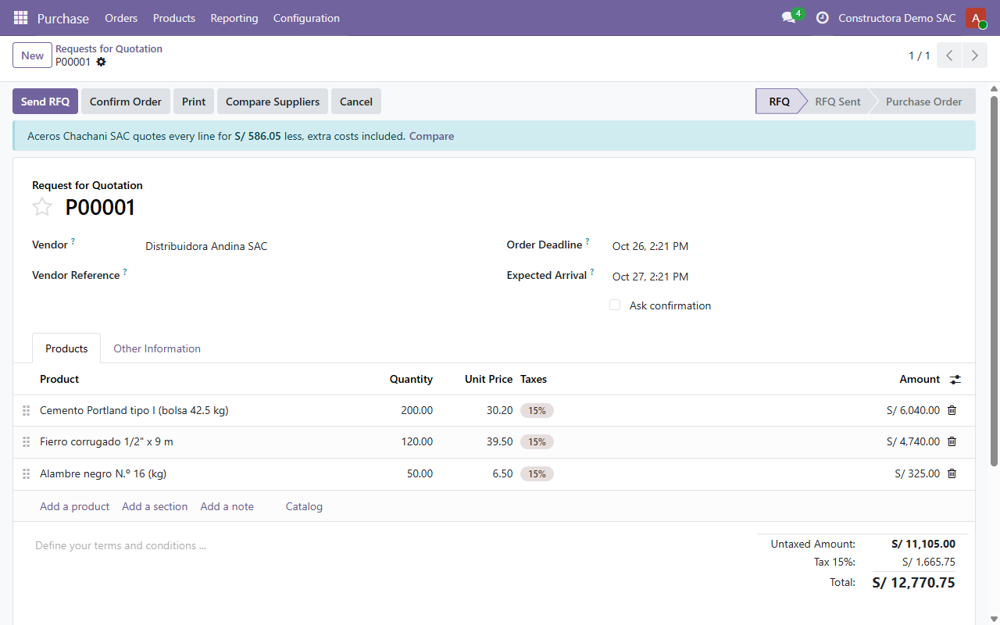
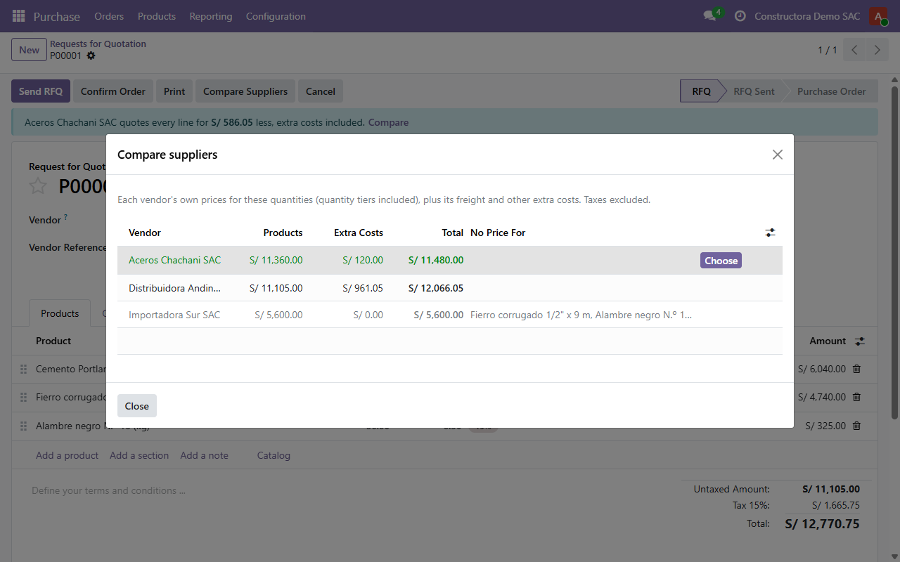
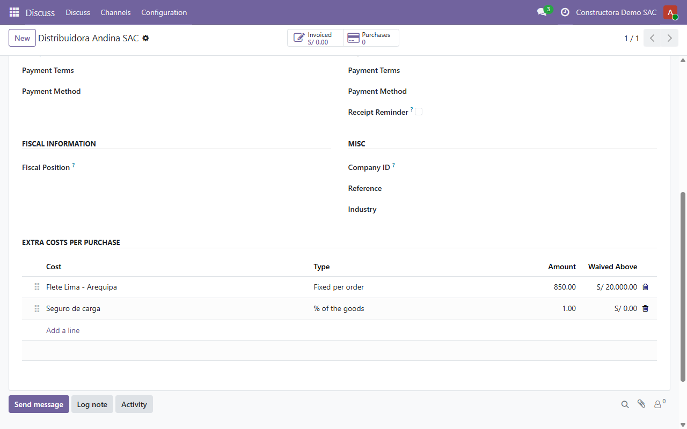

# purchase_supplier_compare

[](https://github.com/sebpost2/purchase_supplier_compare/actions/workflows/tests.yml)

**17 passing tests.** An Odoo 19 addon that answers the buyer's real question
on a request for quotation: which supplier is cheapest for *this* order, once
volume prices, freight and other extra costs are counted. The lowest unit
price often isn't the cheapest order.

> **En español:** compara proveedores en la solicitud de presupuesto por el
> costo total: el precio de cada proveedor según la cantidad (por tramos),
> más su flete, seguro u otros costos por compra. Si otro proveedor sale más
> barato, la solicitud lo avisa con el ahorro exacto, y con un clic pasa a ese
> proveedor con sus precios.

## What it does

- **Volume-tiered prices, Odoo's own way**: a supplier's price tiers are the
  standard vendor price list (several rows per product with a minimum
  quantity). Each line is priced with the tier its quantity reaches, with
  validity dates, the vendor's currency and unit of measure converted to the
  order's.
- **Extra costs per vendor** (`purchase.extra.cost`), on the vendor's Sales &
  Purchase tab: a fixed amount per order (freight, unloading) or a percentage
  of the goods (cargo insurance), optionally waived above an order amount
  (free freight).
- **Banner on the RFQ** when another vendor quotes every line for less, with
  the saving, extra costs included.
- **Compare Suppliers**: every vendor ranked by total. Vendors missing a
  price for some product are listed last, saying which product. **Choose**
  moves the RFQ to that vendor and reprices every line with its prices,
  including lines whose price had been typed by hand.





*Screenshots use fictitious companies and prices.* In them, Distribuidora
Andina has the cheaper goods (S/ 11,105 vs S/ 11,360), but its freight and
insurance make Aceros Chachani S/ 586.05 cheaper for the whole order.

## Design decisions

- **No new price model.** Tiers live in `product.supplierinfo`, and each line
  is priced with Odoo's own `_select_seller`, so the comparison picks exactly
  the price Odoo would put on the line. One rule, not two that drift apart.
- **Extra costs belong to the vendor, not the product.** Freight is charged
  per shipment, so spreading it per unit would hide it on small orders and
  overstate it on big ones.
- **Advise, don't switch.** The RFQ only shows a banner; the buyer chooses.
  Lead time, quality or an open credit line can matter more than S/ 500.

## Running it

```bash
docker compose up -d
docker compose exec odoo odoo -d supplier_compare -i purchase_supplier_compare --without-demo=all --db_host=db --db_user=odoo --db_password=odoo --stop-after-init
```

Open `http://localhost:8069`, add vendor prices on a product's Purchase tab
and extra costs on the vendor's Sales & Purchase tab, then create an RFQ.

## Running the tests

```bash
docker compose exec odoo odoo -d supplier_compare_test -i purchase_supplier_compare --test-enable --test-tags /purchase_supplier_compare --stop-after-init --without-demo=all --db_host=db --db_user=odoo --db_password=odoo
```

CI runs them on every push against the stock `odoo:19` image.

## Scope

Deliberately out of scope: taxes (the comparison is untaxed, as vendor prices
are), splitting one order across several vendors, landed-cost accounting on
receipts (`stock_landed_costs` does that after the purchase; this helps
choose before it), and extra costs that depend on weight or distance.
